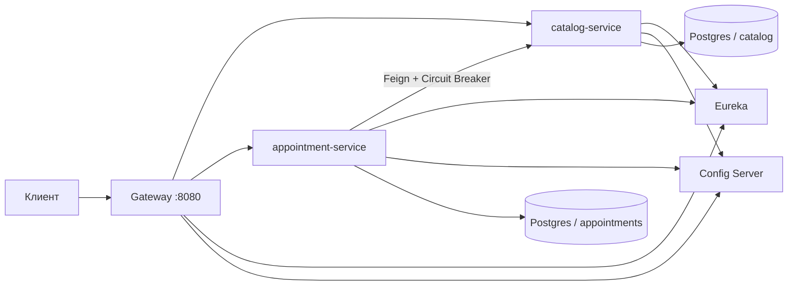

# Стоматология — лабораторная работа №2

Монолит первой лабораторной разрезан на микросервисы. Снаружи API тот же: клиент по-прежнему ходит на `http://localhost:8080/api/v1`. Внутри запрос проходит через Gateway, а сервисы находят друг друга через Eureka и берут настройки из Config Server.

## Что добавлено

| Требование методички | Как сделано |
|---|---|
| Декомпозиция монолита | Каталог и записи — отдельные приложения со своими базами |
| Eureka | `eureka-server`, бизнес-сервисы и Gateway регистрируются в нём |
| Config Server | `config-server` отдаёт YAML из `config-repo/` |
| Spring Gateway | Единая точка входа на порту 8080 |
| Feign Client | Сервис записей вызывает каталог интерфейсом `CatalogClient` |
| Circuit Breaker | Resilience4j вокруг этих вызовов. Методичка ссылается на Hystrix, проект Hystrix больше не развивается, в Spring Cloud его место занял Resilience4j |
| Reactor + R2DBC | `catalog-service`: WebFlux и Spring Data R2DBC |
| Reactor + Spring Data JPA | `appointment-service`: снаружи WebFlux, доступ к базе блокирующий JPA на `boundedElastic` |

Общий Swagger остался один и открывается на Gateway: в выпадающем списке два документа, каталог и записи.

## Как устроены сервисы



- **catalog-service** хранит пользователей, специализации, каталог процедур и связь «врач выполняет процедуру». Специализации — один ко многим, процедуры врача — многие ко многим. Доступ к Postgres реактивный, через R2DBC. Схема создаётся Liquibase по отдельному JDBC-адресу: при наличии R2DBC Spring Boot не поднимает обычный DataSource, и миграции иначе не запускаются.
- **appointment-service** хранит записи и выполненные процедуры. У строки процедуры остаются цена, количество и номер зуба: это бывшая связь многие ко многим с дополнительными полями. Идентификатор процедуры и имя копируются в момент добавления, потому что каталог лежит в другой базе. Создание и перенос записи по-прежнему идут в одной транзакции. Вместо блокировки строк пользователя, которого в этой базе уже нет, транзакция берёт `pg_advisory_xact_lock` по пациенту и врачу, заново проверяет пересечение интервалов и только потом сохраняет запись. Уведомление пишется в лог после commit.
- Имена пациента и врача тоже сохраняются в записи. Пока каталог недоступен, уже созданные записи всё равно читаются.

## Запуск

Нужен Docker с Compose.

```bash
cp .env.example .env
docker compose up --build
```

Если первая лабораторная уже запускалась, остановите её `bootRun` в IDEA и старый `docker compose down`, чтобы освободить порты 8080 и 5432. Данные второй лабораторной лежат в новом томе и не смешиваются со старой базой `dentistry`.

После старта:

- API и Swagger: `http://localhost:8080`, `http://localhost:8080/swagger-ui.html`;
- Eureka: `http://localhost:8761`;
- healthcheck Gateway: `http://localhost:8080/actuator/health`.

Остановка: `docker compose down`. Том с данными удаляет `docker compose down -v`.

Пароль базы берётся из `POSTGRES_PASSWORD`. В файлах Config Server пароль записан как плейсхолдер, его подставляет уже сам сервис, поэтому переменная задана и у каталога, и у записей.

## Конфигурация

Локальный `application.yml` у Gateway, каталога и записей содержит только имя приложения и адрес Config Server. Порт, база, Eureka, таймауты Feign, порог circuit breaker, часовой пояс клиники и маршруты Gateway лежат в `config-repo/`.

| Файл | Кто читает |
|---|---|
| `config-repo/catalog-service/application.yml` | Каталог |
| `config-repo/appointment-service/application.yml` | Записи |
| `config-repo/gateway/application.yml` | Gateway |

Eureka и сам Config Server держат настройки у себя: иначе Config Server не смог бы подняться раньше реестра.

## Маршруты

| Путь | Сервис |
|---|---|
| `/api/v1/users/*/availability` | appointment-service |
| `/api/v1/users/**` | catalog-service |
| `/api/v1/procedures/**` | catalog-service |
| `/api/v1/appointments/**` | appointment-service |

Свободные окна врача остались по старому адресу `GET /api/v1/users/{doctorId}/availability`. Gateway отправляет этот путь в сервис записей, потому что занятые интервалы хранятся там, а рабочие часы врача сервис запрашивает у каталога.

Внутренние методы каталога `/internal/users/{id}` и `/internal/procedures/{id}` через Gateway не опубликованы. Их вызывает только Feign.

## Circuit breaker

Вызовы каталога обёрнуты в `@CircuitBreaker(name = "catalog")`. Метод только вызывает Feign. Если каталог отвечает ошибкой сервера или не отвечает, запасной метод отдаёт клиенту **503** и текст `Catalog service is temporarily unavailable`. Ответ Feign **404** в счётчик сбоев не входит: запасной метод превращает его в обычное «не найдено».

Порог задан в `config-repo/appointment-service/application.yml`: окно из 10 вызовов, минимум 5 вызовов, размыкание при 50% ошибок, пауза 10 секунд.

Проверка: поднять стек, создать пациента и врача, затем остановить каталог командой `docker compose stop catalog-service` и повторить `POST /api/v1/appointments`. Чтение уже существующей записи при этом продолжает работать.

## Что осталось от первой лабораторной

- Те же JSON-контракты, коды ответов и текст ошибок.
- Валидация на контроллере и на сущности.
- Страница пользователей не больше 50 записей, у процедур общее число в заголовке `X-Total-Count`, записи листаются курсором без общего количества.
- Enum в базе хранятся строками.
- Ошибки приходят телом `ApiError`.

## Сборка и тест

```bash
./gradlew test
```

Модульный тест курсора записей не требует Docker. Полный сценарий — это `docker compose up --build` и запросы через Gateway.

Пример пациента:

```bash
curl -X POST http://localhost:8080/api/v1/users \
  -H "Content-Type: application/json" \
  -d '{"fullName":"Иван Иванов","phone":"+79990000010","email":"ivan@example.com","role":"PATIENT"}'
```
